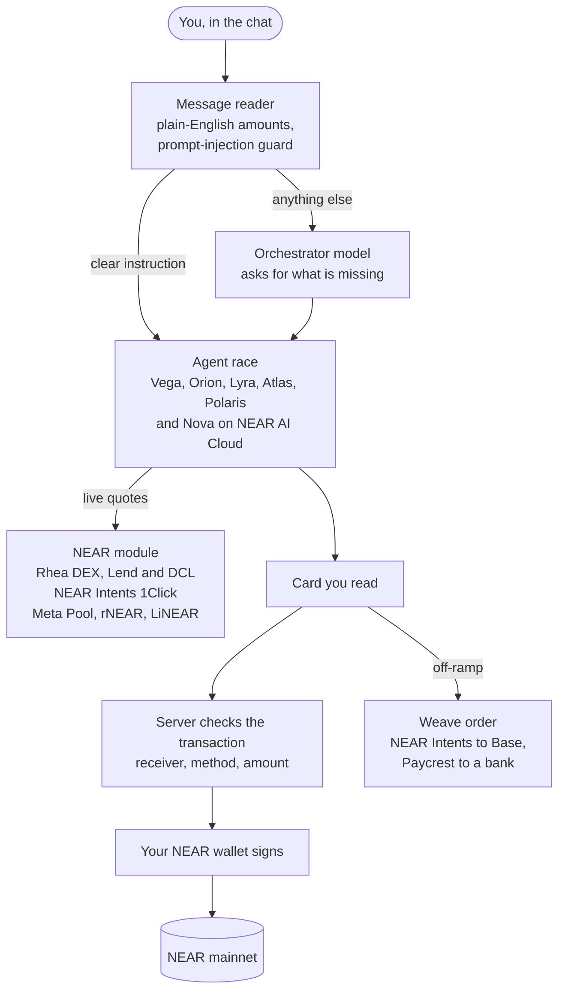
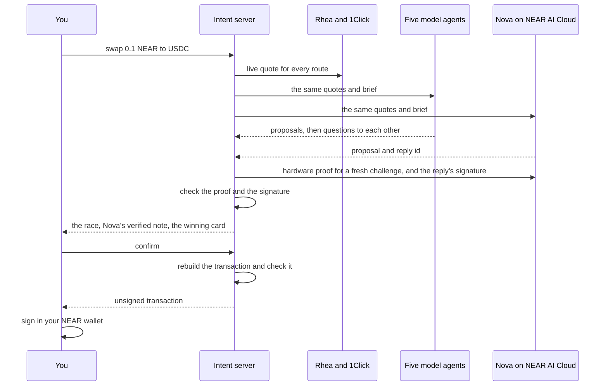
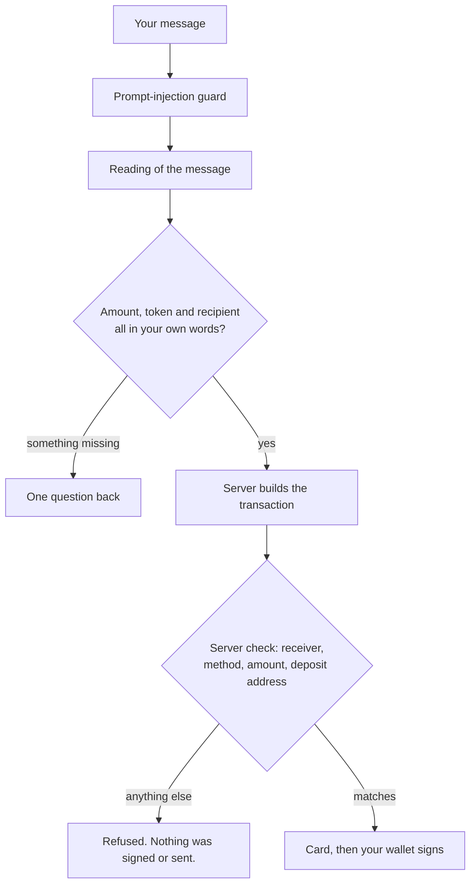
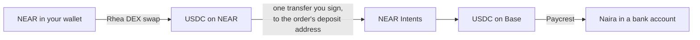

<div align="center">

<br />

```
██╗███╗   ██╗████████╗███████╗███╗   ██╗████████╗
██║████╗  ██║╚══██╔══╝██╔════╝████╗  ██║╚══██╔══╝
██║██╔██╗ ██║   ██║   █████╗  ██╔██╗ ██║   ██║
██║██║╚██╗██║   ██║   ██╔══╝  ██║╚██╗██║   ██║
██║██║ ╚████║   ██║   ███████╗██║ ╚████║   ██║
╚═╝╚═╝  ╚═══╝   ╚═╝   ╚══════╝╚═╝  ╚═══╝   ╚═╝
```

**Say what you want. Agents compete to deliver it.**

_Plain-language requests become onchain transactions: AI agents compete on live quotes for the best
route, every transaction is checked, and you sign it in your own wallet._

<br />

[](LICENSE)
[](https://nextjs.org)
[](https://near.org)
[](https://app.runintent.xyz)

<br />

</div>

---

## NEAR Hackathon

**Only the NEAR integration below was built in the hackathon window and is submitted for judging.**

**Disclosure.** Intent existed before the hackathon as a chat app for trading on Stellar. Its chat,
agent race and interface are baseline. The NEAR side is new: its first commit is from 4 November
2026, two weeks into the window. A file map and the scope for reviewers is in [`AGENTS.md`](AGENTS.md).

| Date         | What                                                                                                                                                           |
| ------------ | -------------------------------------------------------------------------------------------------------------------------------------------------------------- |
| 17 Oct       | Tag `pre-hackathon` (`940b6fb`), the last commit before the 19 Oct announcement. No NEAR code.                                                                 |
| 4 Nov        | First NEAR commit (`326753f`)                                                                                                                                  |
| 5 to 6 Nov   | NEAR wallets, the agent race on NEAR, onchain venues with a way back out of each (#150, #151, #154, #155)                                                      |
| 10 Nov       | NEAR build-out (#167), NEAR AI as a competing agent (#168), its checked enclave proof (#177), LiNEAR (#178), the prompt-injection guard (#179)                 |
| 11 to 12 Nov | Plain-English amounts (#182), asking instead of refusing (#183), off-ramp from NEAR to a bank (#188, #190, #192), finished cards kept in the chat (#187, #189) |
| 14 Nov       | Tag `hackathon-submission`. Diff: [`pre-hackathon...hackathon-submission`](https://github.com/Cookit-labs/Intent/compare/pre-hackathon...hackathon-submission) |

The NEAR code: 24 files and about 7,300 lines in [`lib/chains/near/`](apps/dapp/lib/chains/near),
[`lib/wallet/near-connector.ts`](apps/dapp/lib/wallet/near-connector.ts),
[`lib/weave/deposit/near.ts`](apps/dapp/lib/weave/deposit/near.ts) and
[`lib/agents/brains/nearai-proof.ts`](apps/dapp/lib/agents/brains/nearai-proof.ts) (all under
`apps/dapp`), with 20 `near-*` and `rhea*` test files.

**Tracks:** Unstoppable DeFi, AI Swarms, Real-World Money, Privacy & Private AI, AI Security & Defense.

### System architecture

<p align="center">
  
</p>


<details>
<summary>The same flows as text diagrams</summary>









</details>

### What runs on NEAR

| You type                                       | What happens                                                              | Built on                      |
| ---------------------------------------------- | ------------------------------------------------------------------------- | ----------------------------- |
| `swap 0.1 NEAR to USDC`                        | Agents race live quotes, you sign the winner                              | Rhea DEX, NEAR Intents 1Click |
| `swap 40% of my near to usdc`                  | The share is worked out from your balance first                           | Contract reads                |
| `swap 0.2 NEAR to USDC then off-ramp to naira` | Swap, then pay what arrived to a bank account                             | Rhea DEX, NEAR Intents, Weave |
| `stake 0.1 NEAR on linear`                     | Stake, and later unstake and claim                                        | LiNEAR, rNEAR, Meta Pool      |
| `supply 0.25 USDC to rhea lend`                | Supply, withdraw, borrow, repay                                           | Rhea Lend                     |
| `supply 25 USDC on 1Click Earn`                | Deposit and withdraw                                                      | NEAR Intents                  |
| `send 0.01 NEAR to bob.near`                   | A plain NEAR transfer, keeping enough NEAR for fees                       | Protocol `Transfer` action    |
| `send 5 USDC to <Solana or Sui address>`       | Pays out on that chain, refund comes back to NEAR                         | NEAR Intents 1Click           |
| a limit order on NEAR and USDC                 | Rests in the pool until filled or cancelled                               | Rhea DCL                      |
| `where is my money`                            | Every position, what to type next, and how far a loan is from liquidation | Contract reads                |

A message with a piece missing, such as `swap some near to usdc`, gets one question back instead of a
refusal.

**NEAR partners used:** NEAR Intents (1Click quotes, cross-chain sends, 1Click Earn, the bridge
behind every NEAR off-ramp), Rhea (DEX, Lend, DCL, rNEAR), NEAR AI (Nova) and HOT (wallet connection
through NEAR Connect).

### What keeps your money safe

- **Nova's advice is proven.** Before the chat says Nova's answer was signed inside a verified NEAR AI
  enclave, the server checks NEAR AI's attestation for a fresh challenge (Intel TDX quote, NVIDIA GPU
  attestation) and that the signature over the exact request and response recovers to the attested
  key. If any check fails, no note is shown.
  [`nearai-proof.ts`](apps/dapp/lib/agents/brains/nearai-proof.ts)
- **Outside text can't steer a model.** Token names, venue labels and other agents' words reach a
  model only as data. [`prompt-safe.ts`](apps/dapp/lib/agents/prompt-safe.ts)
- **A model never picks a figure you didn't type.**
  [`parse-sequence.ts`](apps/dapp/lib/chains/parse-sequence.ts)
- **Every NEAR transaction is checked before your wallet sees it:** receiver, method, amount and
  deposit address. [`safety.ts`](apps/dapp/lib/chains/near/safety.ts),
  [`rhea-safety.ts`](apps/dapp/lib/chains/near/rhea-safety.ts),
  [`weave/deposit/near.ts`](apps/dapp/lib/weave/deposit/near.ts)
- **Agents never hold a key.** You sign every transaction, and a send keeps about 0.05 NEAR for fees.

### Proven on NEAR mainnet with a real wallet

| When (UTC)    | What                                               | Transaction                                                                           |
| ------------- | -------------------------------------------------- | ------------------------------------------------------------------------------------- |
| 11 Nov, 10:42 | Stake 0.18 NEAR with rNEAR                         | [`EJVPX2D…`](https://nearblocks.io/txns/EJVPX2D1gNoGiGszDCrQPBPjsJR7iHhAtFbSqbyu3EgC) |
| 11 Nov, 22:52 | Unstake it                                         | [`CMuQUyu…`](https://nearblocks.io/txns/CMuQUyuCPixFsarG76ZkhJkrBQWDDSqdUd9FRcdcFThC) |
| 12 Nov, 02:14 | Swap 0.25 NEAR to 0.900614 USDC on Rhea DEX        | [`HHSztpw…`](https://nearblocks.io/txns/HHSztpwPJ7e66pGU4bZ3jgjfVzsQtHym9SYiadc91rkr) |
| 12 Nov, 02:15 | Off-ramp deposit, paid ₦1,159.98 to a bank         | [`AN8RBZf…`](https://nearblocks.io/txns/AN8RBZfwh6VCFfQU7ewFz9XS63i5LbdJrqTkm6Uh51uK) |
| 12 Nov, 03:18 | Swap 0.3 NEAR to 1.065345 USDC on Rhea DEX         | [`6TeQs8V…`](https://nearblocks.io/txns/6TeQs8VvN2kM2KJ5HkjtPXJs6aBfMbvyTKBX5dFicKPE) |
| 12 Nov, 03:18 | Off-ramp deposit, quoted ₦1,431.28, paid ₦1,431.64 | [`BtC6hBd…`](https://nearblocks.io/txns/BtC6hBdcwangTeBarSFAtXk5HjaMQXrfF3GMfQLVdcTq) |

Every other command in [What runs on NEAR](#what-runs-on-near) was run end to end on production with
a real NEAR account on 12 November, through to a transaction checked and ready to sign. Nova's verified
note showed in each of the seven NEAR races checked on production.

### Try it

**No wallet, no funds:** these read NEAR mainnet and 1Click, and sign nothing.

```bash
pnpm install && cd apps/dapp
pnpm exec vitest run lib/__tests__/near-1click.live.test.ts lib/__tests__/rhea.live.test.ts lib/__tests__/near-contracts.live.test.ts lib/__tests__/near-exits.live.test.ts lib/__tests__/near-rhea-dcl.live.test.ts
```

**In the app:** open [app.runintent.xyz](https://app.runintent.xyz), connect a NEAR wallet, and type
`swap 0.1 NEAR to USDC`. The agents post proposals and question each other, Nova's verified note
appears, then a swap card. Your wallet asks you to sign only when you confirm. It runs on mainnet, so
use small amounts.

**Good to know:** Meta Pool takes at least 1 NEAR per stake. An off-ramp from NEAR has a $0.50
minimum, and about 1.9% goes to the bridge to Base. Sends to EVM chains are refused, because a 0x
address doesn't say which chain it means. Swaps into NEAR through 1Click arrive as wNEAR, so a stake
after one runs as a second request. 1Click Earn deposits depend on NEAR Intents liquidity for its vault.

---

## The repository

```
apps/
├── dapp/                  # The app at app.runintent.xyz (Next.js 15)
│   ├── app/api/           # Route handlers: intent, agents, chain/[chain], cashout, naira
│   ├── components/        # Chat, cards, race panel
│   └── lib/
│       ├── chains/        # One module per chain: near/, solana/, sui/, evm/, plus the registry
│       ├── agents/        # Model providers, scoring, prompt guard, NEAR AI proof
│       ├── orchestrate/   # Reads a message into an action, or one question back
│       ├── weave/ linq/   # Off-ramp providers
│       └── __tests__/     # Vitest, with *.live.test.ts against mainnet
└── website/               # The public landing site
packages/                  # ui, config, db, types, sdk, api-client, eslint-config, tsconfig
```

**Stack:** Next.js 15, React 19, TypeScript, Tailwind, TanStack Query, pnpm workspaces and Turborepo.

### Run it locally

Node 22 and pnpm 9. The app needs Postgres and Redis, so start Docker first.

```bash
git clone https://github.com/Cookit-labs/Intent.git && cd Intent
docker compose up -d
make setup        # install, and copy the .env.example files
make dev          # website on :3000, app on https://localhost:3001
```

Set at least one model key in `apps/dapp/.env.local`: `GROQ_API_KEY` is free. `make test`,
`make lint`, `make typecheck` and `make build` do what they say; `SKIP_LIVE=1 make test` skips tests
that reach a live network. The app's dev server uses a local HTTPS certificate from `mkcert`.

### AI agents

An agent is a model. Each one gets the same live quotes, and goes by a codename in the chat with its
real model beside it ([`identity.ts`](apps/dapp/lib/agents/identity.ts)). Set a key and that model
joins the race:

| Variable             | Codename       | Model                                      |
| -------------------- | -------------- | ------------------------------------------ |
| `ANTHROPIC_API_KEY`  | Vega           | Claude Sonnet                              |
| `DEEPSEEK_API_KEY`   | Orion          | DeepSeek V4 Flash                          |
| `GROQ_API_KEY`       | Lyra           | Qwen on Groq's free plan                   |
| `NEARAI_API_KEY`     | Nova           | GLM 5.3 Flash on NEAR AI Cloud             |
| `OPENROUTER_API_KEY` | Atlas, Polaris | Gemma 4 26B and North Mini Code, both free |

Keys stay on the server: agents run in `app/api/agents/compete`, which streams each proposal as it
lands. With no key or no answer, the chat says the agents aren't available and never makes one up.
Scoring is deterministic code, not a model call. `prompt-injection.test.ts` runs 11 attacks against
each prompt on every chain.

### Access

Mainnet pages sit behind an email gate (`ACCESS_GATE=on|off` overrides it). Accept testers at
`/admin/waitlist` with `ADMIN_TOKEN`. Without `RESEND_API_KEY`, the login code prints in the server
console.

---

<div align="center">

Part of the **[Cookit Labs](https://github.com/Cookit-labs)** ecosystem.

</div>
