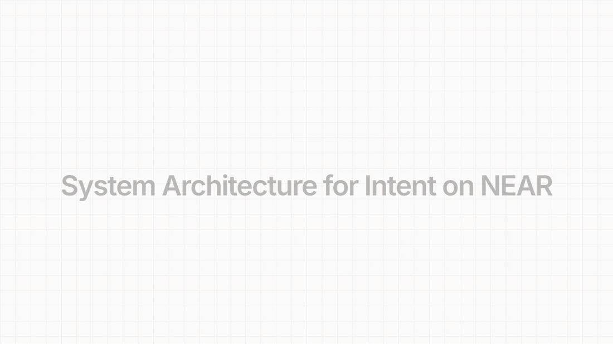
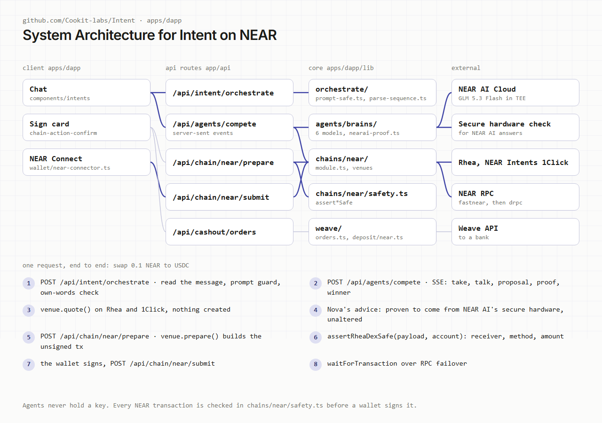
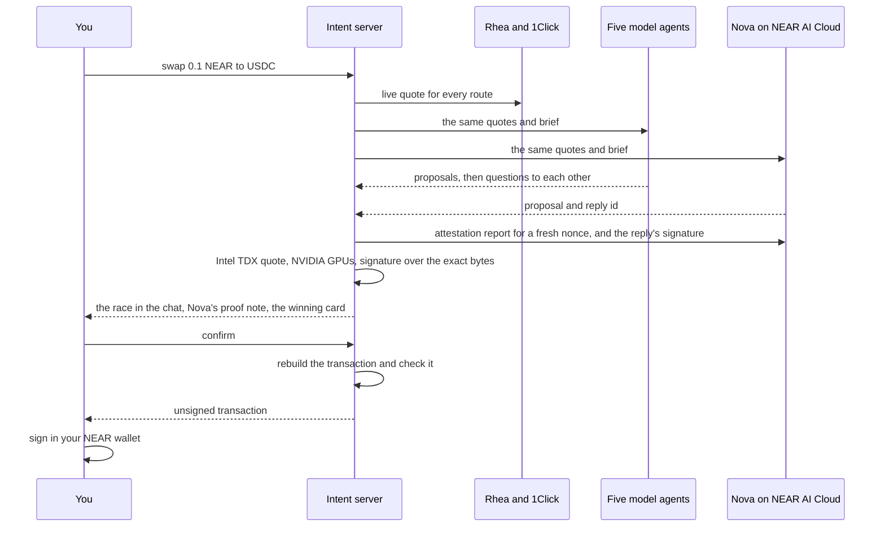
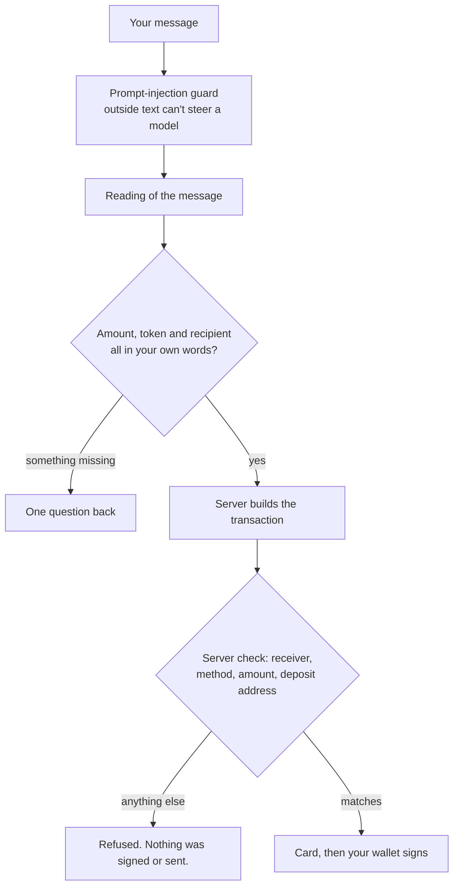
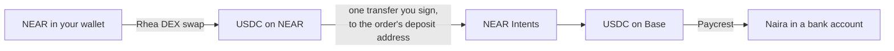

<div align="center">

<br />

```
██╗███╗   ██╗████████╗███████╗███╗   ██╗████████╗
██║████╗  ██║╚══██╔══╝██╔════╝████╗  ██║╚══██╔══╝
██║██╔██╗ ██║   ██║   █████╗  ██╔██╗ ██║   ██║
██║██║╚██╗██║   ██║   ██╔══╝  ██║╚██╗██║   ██║
██║██║ ╚████║   ██║   ███████╗██║ ╚████║   ██║
╚═╝╚═╝  ╚═══╝   ╚═╝   ╚══════╝╚═╝  ╚═══╝   ╚═╝
```

**Autonomous Execution Marketplace on Arc L1**

_Express outcomes. Let agents compete. Settle on-chain._

<br />

[](LICENSE)
[](https://nextjs.org)
[](https://anthropic.com)
[]()

<br />

</div>

---

## NEAR Hackathon

Built at NEAR HACKATHON. **Only the NEAR integration below was built in the hackathon window and is
submitted for judging.**

**Disclosure.** Intent existed before the hackathon as a chat app for trading on Stellar. That
product, including its chat, agent race and interface, is baseline. The NEAR side is new: its first
commit is from 4 November 2026, two weeks into the window. The sections after this one describe the
wider project, and some predate the current app.

### When the NEAR work was built

| Date         | What                                                                                                                                                                         |
| ------------ | ---------------------------------------------------------------------------------------------------------------------------------------------------------------------------- |
| 17 Oct       | Tag `pre-hackathon` (`940b6fb`), the last commit before the 19 Oct announcement. It has no NEAR code.                                                                        |
| 4 Nov        | First NEAR commit (`326753f`, swap, earn and stake on NEAR)                                                                                                                  |
| 5 to 6 Nov   | NEAR wallets, the agent race on NEAR, onchain venues with a way back out of each (#150, #151, #154, #155)                                                                    |
| 10 Nov       | NEAR build-out (#167), NEAR AI as a competing agent (#168), its checked enclave proof (#177), LiNEAR (#178), the prompt-injection guard (#179)                               |
| 11 to 12 Nov | Plain-English amounts (#182), asking for what is missing instead of refusing (#183), off-ramp from NEAR to a bank (#188, #190), finished cards kept in the chat (#187, #189) |
| 14 Nov       | Tag `hackathon-submission`                                                                                                                                                   |

- Diff: [`pre-hackathon...hackathon-submission`](https://github.com/Cookit-labs/Intent/compare/pre-hackathon...hackathon-submission)
- The NEAR code alone: 24 files and about 7,300 lines in
  [`apps/dapp/lib/chains/near/`](apps/dapp/lib/chains/near),
  [`apps/dapp/lib/wallet/near-connector.ts`](apps/dapp/lib/wallet/near-connector.ts),
  [`apps/dapp/lib/weave/deposit/near.ts`](apps/dapp/lib/weave/deposit/near.ts) and
  [`apps/dapp/lib/agents/brains/nearai-proof.ts`](apps/dapp/lib/agents/brains/nearai-proof.ts), with
  20 `near-*` and `rhea*` test files in [`apps/dapp/lib/__tests__/`](apps/dapp/lib/__tests__).

That diff also carries work on other chains. A full file map and the scope for reviewers is in
[`AGENTS.md`](AGENTS.md).

### The problem and the product

Using DeFi on NEAR means knowing which app to open, comparing prices yourself and working through
wrapping, storage deposits and receipts that can fail after a transaction reports success. In
Intent you type what you want in a chat. AI agents compare real quotes, question each other's
choices in the chat and propose a route. You read a card and sign in your own wallet. Agents can't
sign or send anything.

Tracks: Unstoppable DeFi, AI Swarms, Real-World Money, Privacy & Private AI, AI Security & Defense.

### How it fits together

<p align="center">
  
</p>




### What runs on NEAR

| You type                                       | What happens                                                              | Built on                      |
| ---------------------------------------------- | ------------------------------------------------------------------------- | ----------------------------- |
| `swap 0.1 NEAR to USDC`                        | Agents race live quotes, you sign the winner                              | Rhea DEX, NEAR Intents 1Click |
| `swap 40% of my near to usdc`                  | The share is worked out from your balance first                           | Contract reads                |
| `swap 0.2 NEAR to USDC then off-ramp to naira` | Swap, then pay what arrived to a bank account                             | Rhea DEX, NEAR Intents, Weave |
| `stake 0.1 NEAR on linear`                     | Stake, and later unstake and claim                                        | LiNEAR, rNEAR, Meta Pool      |
| `supply 0.25 USDC to rhea lend`                | Supply, withdraw, borrow, repay                                           | Rhea Lend                     |
| `supply 25 USDC on 1Click Earn`                | Deposit and withdraw                                                      | NEAR Intents                  |
| `send 0.01 NEAR to bob.near`                   | A plain NEAR transfer, keeping enough NEAR for fees                       | Protocol `Transfer` action    |
| `send 5 USDC to <Solana or Sui address>`       | Pays out on that chain, refund comes back to NEAR                         | NEAR Intents 1Click           |
| a limit order on NEAR and USDC                 | Rests in the pool until filled or cancelled                               | Rhea DCL                      |
| `where is my money`                            | Every position, what to type next, and how far a loan is from liquidation | Contract reads                |

A message with a piece missing, such as `swap some near to usdc`, gets one question back ("How much
NEAR do you want to swap?") instead of a refusal.

**NEAR ecosystem partners used:** NEAR Intents (1Click quotes, cross-chain sends, 1Click Earn and the
bridge behind every NEAR off-ramp), Rhea (DEX, Lend, DCL and rNEAR), NEAR AI (Nova, with a checked
enclave proof) and HOT (wallet connection through NEAR Connect, `@hot-labs/near-connect`).

**NEAR technology used:** NEAR Intents 1Click API, NEP-141 tokens, NEAR Connect and, for one of the
competing agents, NEAR AI Cloud. That agent, Nova, runs GLM 5.3 Flash, which NEAR's model catalogue
lists as verifiable and attested.

### The agent race, and Nova's proof



**Checked attestation:** the server checks every answer from Nova before the chat says it was
signed in an enclave. With a fresh nonce, it fetches NEAR AI's attestation report and checks these:

- The Intel TDX quote verifies against Intel's own collateral, is up to date, and isn't running in
  debug mode.
- The quote binds the model's signing address and the nonce.
- NVIDIA's attestation service passes the GPUs for the same nonce.
- NEAR AI's signature over the SHA-256 of the exact request and response bytes recovers to that
  attested address. The signature is the model's own, not the gateway's.

Only then does the race show a note: "Nova's answer was signed inside a verified NEAR AI enclave".
If any check fails, no note is shown. A passed enclave check is reused for five minutes.

The check proves the hardware, the debug flag, freshness and the key. It doesn't pin which software
image ran, and every instance of a model shares one key. See
[`nearai-proof.ts`](apps/dapp/lib/agents/brains/nearai-proof.ts).

### What stands between a message and your money



- Outside text (quotes, token names, other agents' words) reaches a model only as data:
  [`prompt-safe.ts`](apps/dapp/lib/agents/prompt-safe.ts).
- A model never picks a figure you didn't type:
  [`parse-sequence.ts`](apps/dapp/lib/chains/parse-sequence.ts).
- Every NEAR transaction is checked on the server before the wallet sees it:
  [`safety.ts`](apps/dapp/lib/chains/near/safety.ts),
  [`rhea-safety.ts`](apps/dapp/lib/chains/near/rhea-safety.ts),
  [`weave/deposit/near.ts`](apps/dapp/lib/weave/deposit/near.ts).
- A send keeps about 0.05 NEAR back, so a wallet can't strand itself without gas.

### Off-ramp from NEAR to a bank



The off-ramp form opens at all the USDC the swap delivered. Weave adds its fee on top of the order,
so an order for most of a balance is sized to leave room for it
([`orders.ts`](apps/dapp/lib/weave/orders.ts)). The deposit is built from the stored order and
checked against it before signing.

### Proven on NEAR mainnet with a real wallet

| When (UTC)    | What                                               | Transaction                                                                           |
| ------------- | -------------------------------------------------- | ------------------------------------------------------------------------------------- |
| 11 Nov, 10:42 | Stake 0.18 NEAR with rNEAR                         | [`EJVPX2D…`](https://nearblocks.io/txns/EJVPX2D1gNoGiGszDCrQPBPjsJR7iHhAtFbSqbyu3EgC) |
| 11 Nov, 22:52 | Unstake it                                         | [`CMuQUyu…`](https://nearblocks.io/txns/CMuQUyuCPixFsarG76ZkhJkrBQWDDSqdUd9FRcdcFThC) |
| 12 Nov, 02:14 | Swap 0.25 NEAR to 0.900614 USDC on Rhea DEX        | [`HHSztpw…`](https://nearblocks.io/txns/HHSztpwPJ7e66pGU4bZ3jgjfVzsQtHym9SYiadc91rkr) |
| 12 Nov, 02:15 | Off-ramp deposit, paid ₦1,159.98 to a bank         | [`AN8RBZf…`](https://nearblocks.io/txns/AN8RBZfwh6VCFfQU7ewFz9XS63i5LbdJrqTkm6Uh51uK) |
| 12 Nov, 03:18 | Swap 0.3 NEAR to 1.065345 USDC on Rhea DEX         | [`6TeQs8V…`](https://nearblocks.io/txns/6TeQs8VvN2kM2KJ5HkjtPXJs6aBfMbvyTKBX5dFicKPE) |
| 12 Nov, 03:18 | Off-ramp deposit, quoted ₦1,431.28, paid ₦1,431.64 | [`BtC6hBd…`](https://nearblocks.io/txns/BtC6hBdcwangTeBarSFAtXk5HjaMQXrfF3GMfQLVdcTq) |

Nova's proof note showed in each of the seven NEAR races checked on production between 11 and 12 November.

### Try it with no wallet and no funds

These read real NEAR mainnet and 1Click. They sign nothing and need no keys.

```bash
pnpm install
cd apps/dapp
pnpm exec vitest run lib/__tests__/near-1click.live.test.ts lib/__tests__/rhea.live.test.ts lib/__tests__/near-contracts.live.test.ts lib/__tests__/near-exits.live.test.ts lib/__tests__/near-rhea-dcl.live.test.ts
```

You should see every test pass. They cover real dry quotes, Rhea pool and lending reads, and
transactions built and checked but never sent.

### Try it in the app

Everything here runs on mainnet, so use small amounts. The app is at
[app.runintent.xyz](https://app.runintent.xyz) and needs a NEAR wallet.

1. Open the app and connect a NEAR wallet. You should land in the chat on NEAR.
2. Type `swap 0.1 NEAR to USDC`. You should see the agents post proposals and question each other,
   Nova's proof note, then a swap card with the amount you'd receive. Your wallet asks you to sign
   only when you confirm.
3. Type `where is my money`. You should see what you hold in each app and what to type next.

To run it locally, follow [Quick Start](#quick-start), then set one model key in
`apps/dapp/.env.local`. `GROQ_API_KEY` is free and enough for one agent.

### How each flow was tested

- **On NEAR mainnet with a real wallet:** the rNEAR stake and unstake, Rhea DEX swaps and the two
  off-ramps to a bank in the table above.
- **End to end on production:** every command in [What runs on NEAR](#what-runs-on-near) was run
  against the live app on 12 November with a real NEAR account: read, routed, quoted and built into a
  transaction the server checked, ready for the wallet. That covers the agent race with Nova's proof,
  LiNEAR stakes, Rhea Lend supplies, NEAR sends, USDC sends to Solana, swap then off-ramp and swap
  then deposit.
- **By tests:** unit tests for every NEAR venue and its safety check, and the live mainnet checks in
  [Try it with no wallet and no funds](#try-it-with-no-wallet-and-no-funds).

### Limits worth knowing

- **Meta Pool** takes at least 1 NEAR per stake.
- **Off-ramp from NEAR:** about 1.9% goes to the bridge to Base, and the payout provider has a $0.50
  minimum.
- **Sends to EVM chains** are refused, because a 0x address doesn't say which chain it means.
- **Swaps into NEAR through 1Click** arrive as wNEAR, so 1Click only runs for them when it's named.
  A stake or send after one stops and says the swap went through.
- **1Click Earn** depends on NEAR Intents liquidity for its vault, Gauntlet USDC Prime. When there
  is none, the deposit is refused with that reason.

---

## What is Intent?

Intent is an execution marketplace for onchain finance, across many tokens and chains. Instead of placing orders manually, users express the **outcome** they want — swap one token for another, stake, lend, send, or off-ramp to a bank. Autonomous AI agents then compete in a timed auction to fulfill that intent.

The best-performing agent wins execution rights, executes the trade using constrained on-chain permissions, and gets its reputation updated on Arc L1.

```
User intent submitted
        │
        ▼
  USDC locked in escrow
        │
        ▼
  Competition opens (30s window)
        │
        ├──► TWAP Agent        (Claude reasons about time-sliced execution)
        ├──► Momentum Agent     (Claude reads market signals, times entry)
        ├──► Shadow Agent       (Claude simulates paths, picks best outcome)
        └──► Arbitrage Agent    (Claude detects cross-venue price gaps)
        │
        ▼
  Proposals scored & winner selected
        │
        ▼
  Winning agent executes on Arc L1
        │
        ▼
  Execution validated on-chain
        │
        ▼
  USDC settled → reputation updated
```

---

## This Repository

This is the **frontend monorepo** — the public website and the execution dApp. It is one part of three:

| Repo                                                                              | What it contains                                   |
| --------------------------------------------------------------------------------- | -------------------------------------------------- |
| **[Intent (this repo)](https://github.com/Cookit-labs/Intent)**                   | Next.js website + dApp frontend                    |
| **[Backend](https://github.com/Cookit-labs/Backend)**                             | Go API, competition engine, reputation, settlement |
| **[intent-core-contracts](https://github.com/Cookit-labs/intent-core-contracts)** | Solidity contracts on Arc L1                       |

---

## Repository Structure

```
intent/
├── apps/
│   ├── website/                  # Public landing site
│   │   └── components/sections/  # Hero, Protocol Viz, Agents, Leaderboard...
│   └── dapp/                     # Execution terminal
│       ├── app/                  # Dashboard, Intents, Competitions, Agents...
│       ├── stores/               # Zustand state (intent, competition, realtime, ui)
│       └── providers/            # wagmi + RainbowKit + TanStack Query
│
└── packages/
    ├── ui/                       # Internal design system
    ├── types/                    # Shared TypeScript types
    ├── config/                   # Env schemas, chain configs, addresses
    ├── sdk/                      # IntentClient + typed WebSocket client
    ├── api-client/               # Generated OpenAPI client
    ├── eslint-config/            # Shared ESLint configs
    └── tsconfig/                 # Shared tsconfig bases
```

---

## Tech Stack

| Layer          | Technology                                                   |
| -------------- | ------------------------------------------------------------ |
| **Frontend**   | Next.js 14 (App Router), TypeScript, Tailwind CSS, shadcn/ui |
| **Animations** | Framer Motion, GSAP, Lenis (smooth scroll)                   |
| **Web3**       | wagmi v2, viem, RainbowKit                                   |
| **State**      | Zustand, TanStack Query v5                                   |
| **Monorepo**   | pnpm workspaces, Turborepo                                   |
| **Chain**      | Arc L1                                                       |

---

## Quick Start

**Prerequisites:** Node 22, pnpm 9

```bash
# Clone
git clone https://github.com/Cookit-labs/Intent.git
cd Intent

# Install dependencies and copy env files
make setup

# Start both apps
make dev
```

| App     | URL                    |
| ------- | ---------------------- |
| Website | http://localhost:3000  |
| dApp    | https://localhost:3001 |

The dApp's dev server runs over HTTPS with a local certificate, because Varial
refuses to sign for a site without one. The first run downloads `mkcert` and
Windows asks to trust its root certificate (`mkcert -uninstall` removes it). The
dApp needs Postgres and Redis for sessions, limits and the sponsor ledger, so
start Docker first: `docker compose up -d`.

---

## Apps

### `apps/website`

Public landing site. Explains the protocol, showcases the agent competition model, and links to the dApp.

**Key sections:**

- Hero with protocol visualization
- How agents compete
- Live leaderboard preview
- Links to the execution terminal

### `apps/dapp`

The execution terminal. Connect your wallet, submit intents, and watch AI agents compete to fulfill them in real-time.

**Routes:**

- `/` — dashboard
- `/intents` — submit & manage intents
- `/competitions` — active competition feed
- `/leaderboard` — agent reputation rankings
- `/agents` — agent detail pages
- `/analytics` — execution performance charts
- `/history` — past executions
- `/vault` — USDC deposit/withdrawal
- `/settings` — user preferences

---

## Common Commands

```bash
make dev          # Start website + dApp
make build        # Build all packages and apps
make typecheck    # TypeScript type checking
make lint         # ESLint across all packages
make test         # Run tests (SKIP_LIVE=1 make test skips the ones that reach testnet)
make format       # Prettier format
make clean        # Clean build artifacts
```

---

## Environment Variables

```bash
# apps/website/.env.local
NEXT_PUBLIC_API_URL=http://localhost:8080

# apps/dapp/.env.local
NEXT_PUBLIC_WALLETCONNECT_PROJECT_ID=your_project_id
NEXT_PUBLIC_API_URL=http://localhost:8080
```

Copy `.env.example` files to get started:

```bash
cp apps/website/.env.example apps/website/.env.local
cp apps/dapp/.env.example apps/dapp/.env.local
```

---

## Access Gate

On for mainnet pages, off for testnet; `ACCESS_GATE=on|off` overrides it. Only
emails marked `accepted` receive a login code. Accept one at `/admin/waitlist`
with `ADMIN_TOKEN`, including an address that has not signed up. Without
`RESEND_API_KEY` the code prints in the dApp's server console instead of being
emailed.

```bash
docker compose up -d          # Postgres :55432, Redis :56379 (non-default: other
                              # local projects commonly hold 5432/6379)
cp apps/dapp/.env.example apps/dapp/.env.local   # then fill AUTH_SECRET + ADMIN_TOKEN
pnpm dev
```

Generate the two secrets:

```bash
node -e "console.log(require('crypto').randomBytes(32).toString('hex'))"   # AUTH_SECRET
node -e "console.log(require('crypto').randomBytes(24).toString('hex'))"   # ADMIN_TOKEN
```

**Flow.** `/verify` asks for an email. Accepted -> a 6-digit code is emailed and a
signed httpOnly cookie is set on success. Not accepted -> routed to `/waitlist`.
Everything under `/[chain]/*` is blocked by middleware until that cookie exists.

**In development no email is sent** — the code prints to the dev-server console.
Set `RESEND_API_KEY` and `EMAIL_FROM` to send real mail.

**Accepting someone:** open `/admin/waitlist`, enter `ADMIN_TOKEN`, click Accept.

| Route             | Purpose                 |
| ----------------- | ----------------------- |
| `/verify`         | Email + OTP sign-in     |
| `/waitlist`       | Public signup           |
| `/admin/waitlist` | Accept / revoke testers |

Codes are stored hashed with a 10-minute TTL, die after 5 wrong attempts, and are
rate-limited to 1/minute and 5/hour per address.

---

## AI Agents

An agent is a model. Each one competes on the same live quotes, so different models really do
disagree. Each goes by a codename in the chat, with its real model beside it in small text
(`lib/agents/identity.ts`). Set any of these keys and that model joins the race, on every chain:

| Variable             | Codename       | Model                                      |
| -------------------- | -------------- | ------------------------------------------ |
| `ANTHROPIC_API_KEY`  | Vega           | Claude Sonnet                              |
| `DEEPSEEK_API_KEY`   | Orion          | DeepSeek V4 Flash                          |
| `GROQ_API_KEY`       | Lyra           | Qwen on Groq's free plan                   |
| `NEARAI_API_KEY`     | Nova           | GLM 5.3 Flash on NEAR AI Cloud             |
| `OPENROUTER_API_KEY` | Atlas, Polaris | Gemma 4 26B and North Mini Code, both free |

`AGENT_BRAINS` overrides the line-up, for example `AGENT_BRAINS=nearai,groq`.

**The keys are server-side only.** Agents run in a route handler (`app/api/agents/compete`) that
streams each proposal as it lands. Nothing under `lib/agents/brains/` may be imported from a
component.

**There is no fallback.** With no key, or when nobody answers, the chat says the agents aren't
available. It never shows a made-up proposal.

**Scoring is deterministic TypeScript**, not a model call, so identical runs score identically.

**Outside text can't steer a model.** Text from outside reaches the models on every chain. That
includes:

- A token's own name, and anyone can airdrop a token into a wallet.
- Venue and route labels.
- Earlier replies and other agents' words.
- Text pasted from a web page.

All of it passes `lib/agents/prompt-safe.ts` first. That file:

- Removes characters nobody can see (zero-width characters, direction overrides, Unicode tag
  characters, private-use characters).
- Folds full-width lookalike letters to plain ones.
- Strips chat template markers.
- Keeps each value to one bounded line, and defuses lines that pose as a new turn.

A token symbol keeps only symbol characters, and is flagged when it uses non-Latin letters, like a
Cyrillic "USDС". Every system prompt says outside text is data, not instructions. None of this is
the last line of defence: every proposal is checked by deterministic code, every transaction is
checked by its chain's safety rules, and the person signs.

`prompt-injection.test.ts` runs 11 attacks against each prompt on all six chains.
`prompt-injection.live.test.ts` sends a scam-token order and a hidden pasted order to the real
chat model.

---

<div align="center">

Part of the **[Cookit Labs](https://github.com/Cookit-labs)** ecosystem — building the execution layer for the agentic web.

</div>
